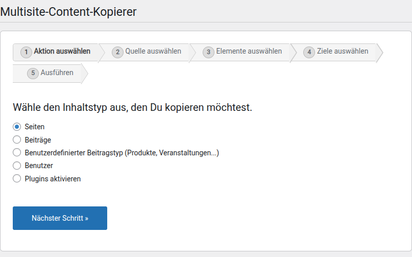

# Multisite Content Copier

[Deutsch](README.md) | **English**

## Create great content once. Use it across your network.

A welcome page for new locations, shared posts for several websites, or an editorial team that needs access to additional sites: **Multisite Content Copier** lets you handle all of this directly from Network Admin.

The wizard guides you from selecting your content to choosing destination sites. You decide what to copy and where it should go.

**Release 1.0.0 · For multisite networks · Requires PHP 8.0 or later**

### What you can do

| Your goal | The right feature |
| --- | --- |
| Provide a standard page on several websites | Copy pages |
| Share posts with other websites | Copy posts, optionally including images, comments and categories |
| Transfer custom content types | Select custom post types, such as products or events |
| Give your editorial team access to more websites | Add existing network users |
| Enable installed plugins on selected websites | Activate plugins |
| Reach the same locations regularly | Organize destination sites into website groups |

### Existing copies stay protected

Pages, posts and custom post types previously copied with the plugin are **skipped** on the same destination site. Your changes there are preserved.

The plugin identifies content by its origin, not just its title. Independently created content with identical titles is therefore not confused with an existing copy.

**Copying is not ongoing synchronization:** Later changes to the original do not overwrite the destination copy. New copy options are not applied retroactively to an existing copy either.

### Your first copy in five steps

1. Open **Network Admin → Content copier** and select **Pages**, for example.
2. Select the website containing the original content.
3. Select the content you want and click **Add elements to the list**.
4. Choose a destination site or a website group. For individual sites, you must also click **Add page**.
5. Click **Next step »** to queue the job. Then open the destination site and check the copied content.

> **Important:** After you select the destinations, the next step queues the job without an additional confirmation page. The wizard's completion message does not replace checking the destination site: The job is processed when that site is next visited.

### What you need

- An existing **ClassicPress or WordPress multisite network**.
- An account with access to **Network Admin**; the copy box in the post editor requires Super Admin privileges.
- **PHP 8.0 or later**. For everyday use, we recommend a currently supported PHP version offered by your hosting provider.
- The appropriate plugins on both the source and destination sites when copying additional content types.

### Choose your language

German and **English (United States)** are supported. Choose your interface language under **Users → Profile → Language**. Without a personal language preference, the plugin follows the site language. The English translation is included as PO/MO files; no additional plugin setting is needed.

### Installation

1. Open **Network Admin → Plugins → Add New**.
2. Use **Upload Plugin** to upload and install the plugin ZIP file.
3. Select **Network Activate**.
4. Open the new **Content copier** menu item.

No additional configuration is needed for your first copies. The settings relate to the optional **PS Blog Templates integration**.

### Good to know

- Originals are not moved or deleted.
- Published content stays published; drafts stay drafts. Check the status before copying.
- **Copy images** must be explicitly selected to include images.
- Users are added to another website, not created as new accounts.
- **Activate plugins** does not transfer plugin files or settings.
- The plugin is not a complete website cloner: Themes, menus and website settings are not transferred as a single package.
- Try new workflows with a small amount of content on a single destination site first.

## The complete handbook

**[Open the illustrated user handbook (German)](docs/index.md)**

It covers the full step-by-step workflow, all copy options, website groups, the copy box in the editor and answers to common questions. The handbook and its screenshots are currently in German.

---

**PSOURCE · Multisite Content Copier · GPLv2 or later**
