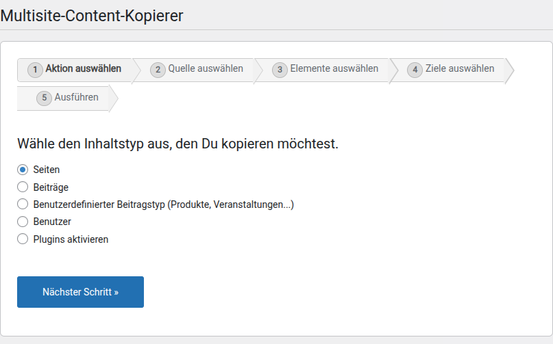

# Multisite-Content-Kopierer

**Deutsch** | [English](README.en.md)

## Gute Inhalte einmal erstellen. Im ganzen Netzwerk nutzen.

Eine Willkommensseite für neue Standorte, gemeinsame Beiträge für mehrere Websites oder ein Redaktionsteam, das auf weiteren Websites mitarbeiten soll: Mit dem **Multisite-Content-Kopierer** erledigst du das direkt in deiner Netzwerkverwaltung.

Der Assistent führt dich von der Auswahl der Inhalte bis zu den Zielwebsites. Du entscheidest, was übernommen wird und wohin.

**Release 1.0.0 · Für Multisite-Netzwerke · PHP ab 8.0**

### Was du damit machen kannst

| Dein Vorhaben | Die passende Funktion |
| --- | --- |
| Eine Standardseite auf mehreren Websites bereitstellen | Seiten kopieren |
| Beiträge in andere Websites übernehmen | Beiträge kopieren, auf Wunsch mit Bildern, Kommentaren und Kategorien |
| Eigene Inhaltstypen übertragen | Benutzerdefinierte Beitragstypen auswählen, etwa Produkte oder Veranstaltungen |
| Dein Redaktionsteam auf weitere Websites bringen | Bestehende Netzwerkbenutzer hinzufügen |
| Bereits installierte Plugins auf ausgewählten Websites einschalten | Plugins aktivieren |
| Wiederkehrend dieselben Standorte erreichen | Zielwebsites in Webseiten-Gruppen organisieren |

### Vorhandene Kopien bleiben geschützt

Bereits mit dem Plugin kopierte Seiten, Beiträge und eigene Inhaltstypen werden auf derselben Zielwebsite **übersprungen**. Deine dortigen Änderungen bleiben erhalten.

Das Plugin erkennt die Herkunft eines Inhalts, nicht nur seinen Titel. Gleichnamige, unabhängig angelegte Inhalte werden deshalb nicht miteinander verwechselt.

**Kopieren ist keine laufende Synchronisierung:** Spätere Änderungen am Original überschreiben die Zielkopie nicht. Auch neue Kopieroptionen werden nicht nachträglich auf eine vorhandene Kopie angewendet.

### In fünf Schritten zur ersten Kopie

1. Öffne **Netzwerkverwaltung → Content Kopierer** und wähle beispielsweise **Seiten**.
2. Wähle die Website aus, auf der sich das Original befindet.
3. Markiere die gewünschten Inhalte und klicke auf **Elemente zur Liste hinzufügen**.
4. Wähle die Zielwebsite oder eine Webseiten-Gruppe. Bei einzelnen Websites musst du auch **Seite hinzufügen** anklicken.
5. Klicke auf **Nächster Schritt »**, um den Auftrag anzulegen. Öffne danach die Zielwebsite und prüfe die übernommenen Inhalte.

> **Wichtig:** Nach der Zielauswahl startet der nächste Schritt den Auftrag ohne zusätzliche Bestätigungsseite. Die Meldung im Assistenten ersetzt nicht die Kontrolle auf der Zielwebsite: Dort wird der Auftrag beim nächsten Aufruf verarbeitet.

### Was du brauchst

- Ein eingerichtetes **ClassicPress- oder WordPress-Multisite-Netzwerk**.
- Ein Konto mit Zugriff auf die **Netzwerkverwaltung**; für die Kopierbox im Beitragseditor brauchst du Superadministrator-Rechte.
- **PHP 8.0 oder neuer**. Für den Betrieb empfehlen wir eine aktuell unterstützte PHP-Version deines Hosters.
- Für zusätzliche Inhaltstypen die passenden Plugins auf den Quell- und Zielwebsites.

### Installation

1. Öffne die **Netzwerkverwaltung → Plugins → Installieren**.
2. Lade die Plugin-ZIP über **Plugin hochladen** hoch und installiere sie.
3. Wähle **Netzwerkweit aktivieren**.
4. Öffne den neuen Menüpunkt **Content Kopierer**.

Für die ersten Kopien brauchst du keine zusätzliche Konfiguration. Die Einstellungen betreffen die optionale **PS Blog Templates-Integration**.

### Gut zu wissen

- Originale werden nicht verschoben oder gelöscht.
- Veröffentlichtes bleibt veröffentlicht; Entwürfe bleiben Entwürfe. Prüfe den Status vor der Kopie.
- **Bilder kopieren** muss für eine Bildübernahme ausdrücklich ausgewählt werden.
- Benutzer werden einer weiteren Website hinzugefügt, nicht als neue Konten angelegt.
- Bei **Plugins aktivieren** werden keine Plugin-Dateien oder Einstellungen übertragen.
- Das Plugin ist kein vollständiger Website-Kloner: Themes, Menüs und Website-Einstellungen werden nicht als Gesamtpaket übernommen.
- Teste neue Abläufe zunächst mit wenigen Inhalten auf einer einzelnen Zielwebsite.

## Das vollständige Handbuch

**[Zum bebilderten Benutzerhandbuch](docs/index.md)**

Dort findest du die komplette Schritt-für-Schritt-Anleitung, alle Kopieroptionen, Webseiten-Gruppen, die Kopierbox im Editor und Hilfe bei typischen Fragen.

---

**PSOURCE · Multisite-Content-Kopierer · GPLv2 oder neuer**
