# Benutzerhandbuch: Multisite-Content-Kopierer

**Release 1.0.0**

Mit dem Multisite-Content-Kopierer übernimmst du ausgewählte Inhalte innerhalb deines Multisite-Netzwerks auf andere Websites. Dieses Handbuch begleitet dich von der ersten Kopie bis zur Arbeit mit Webseiten-Gruppen.

Die Screenshots zeigen eine ClassicPress-Testumgebung mit den Demo-Websites **Handbuch – Quelle** und **Handbuch – Ziel**. Namen und IDs sind Beispiele. In deinem Netzwerk können einzelne Beschriftungen und die Darstellung abweichen.

## Inhalt

1. [Voraussetzungen](#voraussetzungen)
2. [Installation und Orientierung](#installation)
3. [Vor dem ersten Kopieren](#vorbereitung)
4. [Seiten und Beiträge kopieren](#seiten-kopieren)
5. [Die Zusatzoptionen verstehen](#zusatzoptionen)
6. [Was bei erneutem Kopieren passiert](#vorhandene-kopien)
7. [Webseiten-Gruppen verwenden](#gruppen)
8. [Direkt aus dem Editor kopieren](#editor)
9. [Benutzer übernehmen](#benutzer)
10. [Plugins aktivieren](#plugins)
11. [Eigene Beitragstypen kopieren](#beitragstypen)
12. [PS Blog Templates verwenden](#blog-templates)
13. [Kopieraufträge und größere Netzwerke](#kopierauftraege)
14. [Ergebnisse prüfen und Probleme lösen](#hilfe)
15. [Häufige Fragen](#fragen)

## 1. Voraussetzungen

Du brauchst:

- Ein eingerichtetes **ClassicPress- oder WordPress-Multisite-Netzwerk**. Das Plugin ist nicht für eine alleinstehende Einzelwebsite gedacht.
- Zugang zur **Netzwerkverwaltung**. Die Kopierbox im Editor ist für Superadministratoren vorgesehen.
- **PHP ab Version 8.0**. Nutze nach Möglichkeit eine PHP-Version, die noch Sicherheitsupdates erhält.
- Mindestens eine Quellwebsite mit Inhalten und eine andere Website als Ziel.

Bei eigenen Beitragstypen, beispielsweise Produkten oder Veranstaltungen, müssen die dazugehörigen Funktionen auch auf der Zielwebsite verfügbar sein.

## 2. Installation und Orientierung

### Plugin installieren

1. Wechsle über **Meine Websites → Netzwerkverwaltung** in die Netzwerkverwaltung.
2. Öffne **Plugins → Installieren → Plugin hochladen**.
3. Wähle die ZIP-Datei des Multisite-Content-Kopierers.
4. Installiere das Plugin und klicke auf **Netzwerkweit aktivieren**.

Wenn das Plugin bereits installiert ist, genügt die netzwerkweite Aktivierung in der Plugin-Liste.

### Die drei Arbeitsbereiche

| Menüpunkt | Hier erledigst du |
| --- | --- |
| **Content Kopierer** | Inhalte auswählen und Kopieraufträge starten |
| **Content Kopierer → Seiten-Gruppen** | Gruppen anlegen und Websites zuordnen |
| **Content Kopierer → Einstellungen** | Die optionale PS Blog Templates-Integration einschalten |

Die ersten beiden Bereiche reichen für die normale Benutzung aus.

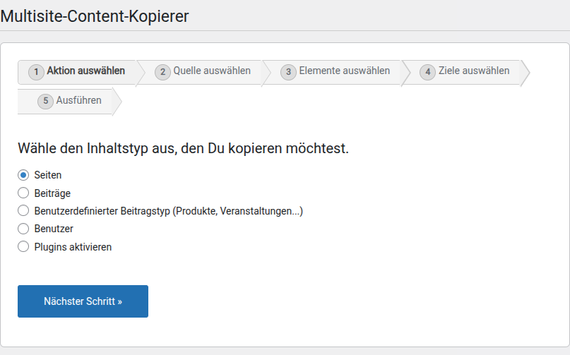

*Der Assistent zeigt oben deinen aktuellen Schritt.*

## 3. Vor dem ersten Kopieren

### Quelle und Ziel unterscheiden

- **Quellwebsite:** Hier befindet sich das Original.
- **Zielwebsite:** Hier soll eine Kopie entstehen.
- **Seite als Inhalt:** Eine einzelne Inhaltsseite, zum Beispiel „Über uns“.
- **Website als Ziel:** Ein vollständiger Standort innerhalb deines Netzwerks.

Die Oberfläche verwendet teilweise „Seite“, „Webseite“ und „Blog“ für eine Website. Prüfe deshalb immer, ob gerade ein Inhalt oder ein Ziel gemeint ist.

### Kurze Checkliste

- [ ] Das Original ist gespeichert und enthält die gewünschten Inhalte.
- [ ] Der Veröffentlichungsstatus passt: Ein veröffentlichter Inhalt wird auch auf dem Ziel veröffentlicht.
- [ ] Quellwebsite und Zielwebsite sind eindeutig.
- [ ] Die benötigten Plugins sind auf der Zielwebsite aktiv.
- [ ] Du weißt, ob Bilder, Kommentare und Kategorien mit übernommen werden sollen.
- [ ] Für wichtige Zielwebsites liegt eine Sicherung vor.

**Empfehlung:** Beginne mit einer einzelnen Seite und einer einzelnen Zielwebsite. Prüfe das Ergebnis, bevor du viele Inhalte oder alle Websites auswählst.

## 4. Seiten und Beiträge kopieren

Im Beispiel übernehmen wir **„Willkommen im Netzwerk“** von **Handbuch – Quelle** auf **Handbuch – Ziel**.

### Schritt 1: Aktion auswählen

1. Öffne **Content Kopierer** in der Netzwerkverwaltung.
2. Wähle **Seiten**.
3. Klicke auf **Nächster Schritt »**.

Für Blogbeiträge wählst du stattdessen **Beiträge**. Die weiteren Schritte sind weitgehend gleich.

### Schritt 2: Quelle auswählen

Du hast zwei Möglichkeiten:

- Gib die **Website-ID** in das erste Feld ein.
- Oder suche über **Webseiten-URL** nach dem Unterordner beziehungsweise der Subdomain.

Bei einer Adresse wie `example.org/berlin/` suchst du nach `berlin`. Bei `berlin.example.org` ebenfalls.

**Klicke einen Suchvorschlag an.** Nur den Namen einzutippen reicht nicht: Durch die Auswahl wird die Website-ID übernommen.

Prüfe die ausgewählte Quelle und klicke auf **Nächster Schritt »**.

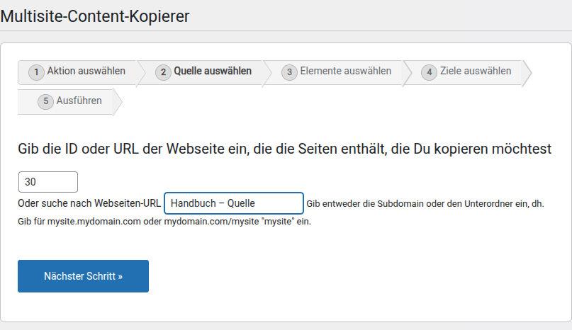

*Die ID 30 gehört nur zur abgebildeten Demo. Verwende die ID deiner eigenen Quellwebsite.*

### Schritt 3: Elemente auswählen

1. Suche den gewünschten Inhalt in der Liste.
2. Setze das Häkchen neben dem Titel.
3. Klicke auf **Elemente zur Liste hinzufügen**.
4. Kontrolliere, dass der Titel nun **oberhalb der Zusatzoptionen in der Auswahlliste** steht.
5. Wähle bei Bedarf die [Zusatzoptionen](#zusatzoptionen).
6. Klicke auf **Nächster Schritt »**.

> **Wichtig:** Das Häkchen in der Tabelle allein übernimmt den Inhalt noch nicht in die Kopierauswahl. Entscheidend ist die separate Auswahlliste.

Mit **Entfernen** nimmst du einen Inhalt wieder aus der Auswahlliste. Das löscht nicht das Original.

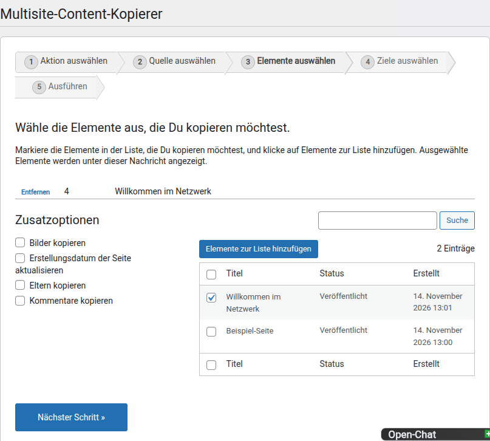

*Die Zeile „Willkommen im Netzwerk“ oberhalb der Optionen bestätigt die Auswahl.*

### Schritt 4: Ziele auswählen

#### Eine oder mehrere einzelne Websites

1. Wähle **Einzelne Seite(n)**.
2. Trage die Website-ID ein oder wähle die Website über die URL-Suche aus.
3. Klicke auf **Seite hinzufügen**.
4. Prüfe, dass die Zielwebsite in der Liste erscheint.
5. Wiederhole die Schritte für weitere Zielwebsites.

Eine Website aus der Liste entfernst du mit **Entfernen**. Dadurch wird nur die Auswahl geändert.

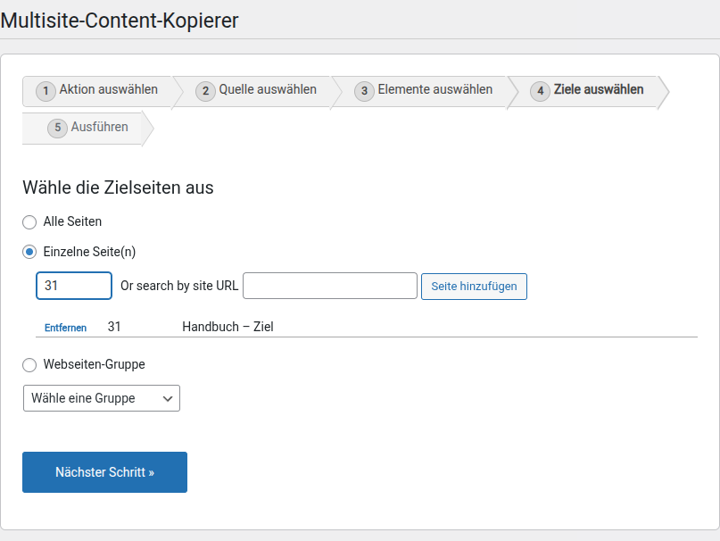

*Auch hier reicht die Eingabe allein nicht: Die Website muss in der Zielliste stehen.*

#### Eine Webseiten-Gruppe

Wähle **Webseiten-Gruppe** und danach die gewünschte Gruppe im Auswahlfeld. Wie du Gruppen anlegst, steht im [Gruppen-Kapitel](#gruppen).

#### Alle Websites

Mit **Alle Seiten** richtest du den Auftrag an die Websites des Netzwerks. Die Quellwebsite selbst wird nicht nochmals mit einer Kopie ihres Originals versorgt.

Verwende diese Auswahl nur, wenn der Inhalt wirklich für das gesamte Netzwerk bestimmt ist.

### Schritt 5: Auftrag anlegen und Ergebnis prüfen

Kontrolliere **vor dem nächsten Klick** die gewählten Inhalte, Optionen und Ziele.

**Nächster Schritt »** nach der Zielauswahl legt den Kopierauftrag an. Es folgt keine zusätzliche Bestätigungsseite.

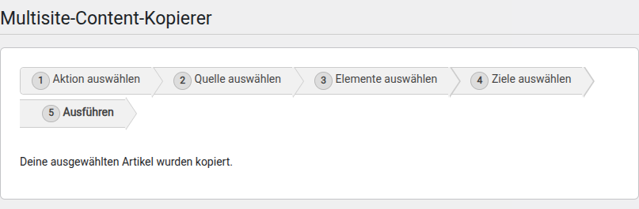

**Die Abschlussmeldung ist noch keine Kontrolle aller Zielwebsites.** Die Verarbeitung findet beim nächsten Aufruf der jeweiligen Zielwebsite statt.

1. Öffne das Dashboard der Zielwebsite, nicht nur die Netzwerkverwaltung.
2. Öffne dort **Seiten** beziehungsweise **Beiträge**.
3. Suche die Kopie.
4. Öffne sie und prüfe Inhalt, Veröffentlichungsstatus und gegebenenfalls Bilder und Zuordnungen.
5. Prüfe danach die öffentliche Ansicht.

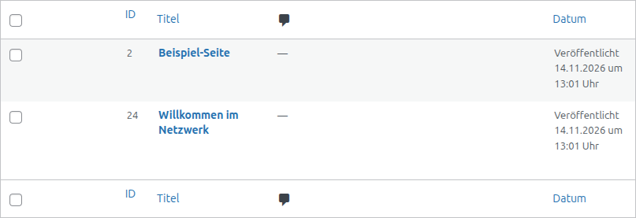

*Die Kopie gehört jetzt zur Zielwebsite. Das Original bleibt auf der Quellwebsite erhalten.*

## 5. Die Zusatzoptionen verstehen

Die Zusatzoptionen gelten für **neu erstellte Kopien**. Sie verändern keine bereits vorhandenen Kopien.

| Option | Bedeutung | Wann sinnvoll? |
| --- | --- | --- |
| **Bilder kopieren** | Übernimmt die zugehörigen Bilder. Für die Übernahme von Beitragsbildern muss diese Option ausgewählt sein. | Wenn die Zielwebsite eigene Bilddateien erhalten soll |
| **Erstellungsdatum … aktualisieren** | Setzt das Datum der neuen Kopie auf den Zeitpunkt der Verarbeitung. Ohne die Option wird das ursprüngliche Datum übernommen. | Wenn die Kopie als neuer Inhalt erscheinen soll |
| **Eltern kopieren** | Übernimmt übergeordnete Inhalte und ordnet die neue Kopie der passenden Elternseite zu. Bereits vorhandene Elternkopien werden wiederverwendet. | Bei hierarchischen Seiten, etwa „Angebote → Beratung“ |
| **Kommentare kopieren** | Übernimmt die Kommentare des Originals. | Wenn die Diskussion zum Inhalt gehören soll |
| **Bedingungen kopieren (Tags & Kategorien)** | Übernimmt Kategorien, Schlagwörter beziehungsweise die zugehörigen Begriffe. Diese Option erscheint bei Beiträgen und passenden eigenen Beitragstypen. | Wenn die Einordnung auf der Zielwebsite benötigt wird |

### Hinweise zu Bildern

Ohne **Bilder kopieren** können eingebundene Bilder weiterhin auf Dateien der Quellwebsite verweisen. Das ist nicht dasselbe wie eine eigene Bildübernahme auf dem Ziel.

Prüfe bei aktivierter Bildoption sowohl den Inhalt als auch das Beitragsbild und die Mediathek der Zielwebsite. Externe oder nicht erreichbare Bilder brauchen eine zusätzliche Kontrolle.

### Hinweise zu Veröffentlichung und Darstellung

Der Inhalt behält grundsätzlich seinen Status. Ein **Entwurf** bleibt ein Entwurf; ein **veröffentlichter** Inhalt kann auf der Zielwebsite sofort öffentlich sein.

Theme, Seitenvorlagen und Funktionen der Zielwebsite bestimmen die Darstellung. Eine korrekt übernommene Seite kann dort anders aussehen als auf der Quelle.

## 6. Was bei erneutem Kopieren passiert

Das Plugin erkennt, aus welcher **Quellwebsite** und welchem **Originalinhalt** eine Kopie stammt.

Für dieselbe Kombination auf derselben Zielwebsite gilt:

- Die vorhandene Kopie wird **übersprungen**.
- Es wird kein zweiter Inhalt dafür angelegt.
- Lokale Änderungen an Text und Seitenhierarchie bleiben erhalten.
- Kommentare und weitere ausgewählte Bestandteile werden nicht erneut kopiert.
- Eine bereits kopierte Elternseite wird bei neuen untergeordneten Seiten wiederverwendet.

Das gilt auch, wenn du denselben Inhalt mehrfach auswählst oder später über eine andere Zielgruppe erneut an dieselbe Website sendest.

### Was die Erkennung nicht tut

Sie gleicht **keine Titel oder Texte** ab. Ein unabhängig angelegter Inhalt mit demselben Titel ist nicht automatisch dieselbe Kopie.

Sie ist auch keine Synchronisierung. Änderungen am Original und nachträglich gewählte Bild- oder Kommentaroptionen aktualisieren eine vorhandene Kopie nicht. Bearbeite diese bei Bedarf direkt auf der Zielwebsite.

### Wenn eine Kopie im Papierkorb liegt

Auch eine Kopie im Papierkorb zählt als vorhanden. Ein neuer Kopierlauf legt deshalb keinen Ersatz an und stellt den Inhalt nicht ungefragt wieder her.

Stelle den Inhalt auf der Zielwebsite aus dem Papierkorb wieder her, wenn du ihn weiterverwenden möchtest.

Erst nach dem **endgültigen Löschen** kann ein neuer Kopierlauf eine neue Kopie anlegen. Sichere vorher wichtige lokale Änderungen.

## 7. Webseiten-Gruppen verwenden

Gruppen sind gespeicherte Zusammenstellungen von Zielwebsites. Sie eignen sich beispielsweise für Standorte, Sprachbereiche oder Kundenprojekte.

### Eine Gruppe anlegen

1. Öffne **Content Kopierer → Seiten-Gruppen**.
2. Wähle den Tab **Gruppen**.
3. Gib unter **Neue Gruppe hinzufügen** einen verständlichen Namen ein.
4. Klicke auf **Neue Gruppe hinzufügen**.

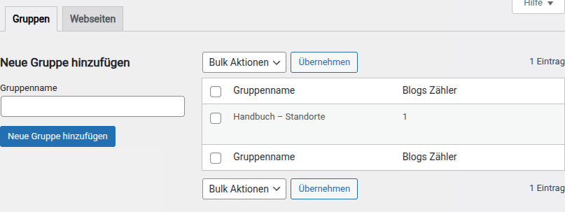

*„Handbuch – Standorte“ ist eine Beispielgruppe.*

### Websites zuordnen

1. Wechsle zum Tab **Webseiten**.
2. Suche die gewünschten Websites nach ihrem URL-Bestandteil oder ihrer ID.
3. Setze die Häkchen neben den Websites.
4. Wähle oben die Zielgruppe aus.
5. Klicke auf **Zu Gruppe zuweisen**.
6. Prüfe die Spalte **Gruppen**.

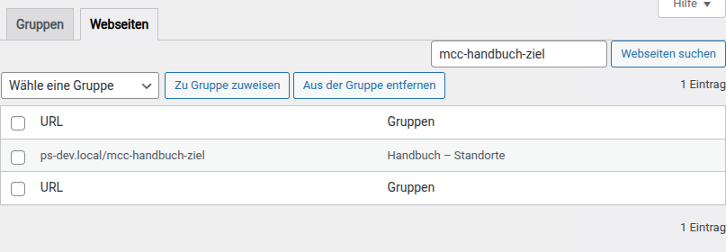

*Die Gruppen-Spalte zeigt, zu welchen Gruppen eine Website gehört.*

Eine Website kann zu mehreren Gruppen gehören. Zum Entfernen wählst du Website und Gruppe aus und klickst auf **Aus der Gruppe entfernen**.

### Eine Gruppe als Kopierziel verwenden

Wähle im vierten Assistentenschritt **Webseiten-Gruppe** und die passende Gruppe. Der Auftrag wird für die zugeordneten Websites angelegt.

Prüfe die Mitgliedschaft vor größeren Kopieraktionen. Eine Gruppe ist eine Zielauswahl, keine automatische Verbindung für spätere Änderungen.

## 8. Direkt aus dem Editor kopieren

Für einzelne gespeicherte Inhalte gibt es im klassischen Editor die Box **Multisite Content Kopierer: Inhalte kopieren**.

1. Öffne einen bestehenden Beitrag, eine Seite oder einen unterstützten eigenen Beitragstyp zum Bearbeiten.
2. Speichere deine Änderungen, bevor du kopierst.
3. Suche die Kopierbox. Sie befindet sich unterhalb des Editors; gegebenenfalls musst du nach unten scrollen.
4. Wähle **Webseiten-Gruppe** oder bewusst **Alle Webseiten**.
5. Wähle die gewünschten Zusatzoptionen.
6. Klicke auf **Kopieren**.
7. Öffne die Zielwebsite und kontrolliere das Ergebnis.

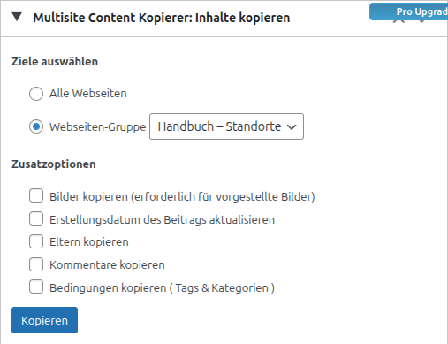

**Der Kopieren-Button legt den Auftrag direkt an.** Er speichert nicht gleichzeitig ungespeicherte Änderungen am Original.

Für einzelne Zielwebsites ohne Gruppe verwendest du den Netzwerk-Assistenten. Die Editorbox bietet diese individuelle Zielliste nicht an.

Bereits vorhandene Kopien werden auch bei diesem Weg übersprungen.

## 9. Benutzer übernehmen

In einer Multisite sind Benutzerkonten bereits netzwerkweit vorhanden. Das Plugin fügt ausgewählte Konten einer weiteren Website hinzu; es erstellt keine zusätzlichen Konten mit neuen Passwörtern.

### Ausgewählte Benutzer hinzufügen

1. Wähle im ersten Assistentenschritt **Benutzer**.
2. Wähle die Website aus, deren Benutzer du übernehmen möchtest.
3. Wähle **Ausgewählte Benutzer**.
4. Suche die gewünschten Konten und markiere sie.
5. Klicke auf **Elemente zur Liste hinzufügen**.
6. Prüfe die separate Auswahlliste oberhalb der Tabelle.
7. Wähle die Zielwebsites und lege den Auftrag an.
8. Öffne auf der Zielwebsite **Benutzer → Alle Benutzer**.
9. Kontrolliere die übernommenen Konten und ihre Rollen.

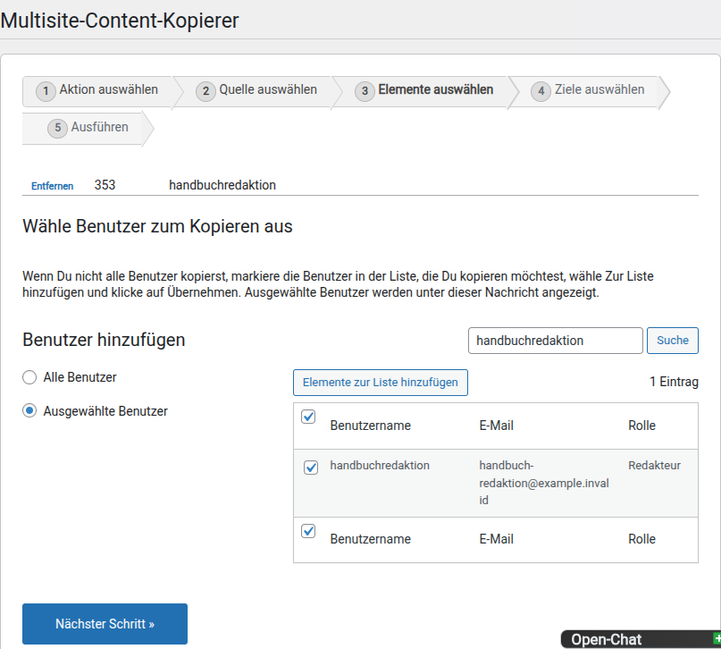

*Die abgebildete E-Mail-Adresse ist eine nicht zustellbare Demo-Adresse.*

### Alle Benutzer einer Quelle hinzufügen

Mit **Alle Benutzer** werden die Benutzer der ausgewählten Quellwebsite übernommen. Prüfe vorher, ob wirklich alle diese Konten Zugriff auf die Ziele erhalten sollen.

### Rollen und bestehende Mitgliedschaften

- Eine vorhandene Rolle der Quelle wird übernommen, wenn sie auf der Zielwebsite verfügbar ist.
- Ist die Rolle dort nicht verfügbar, ist die Standard-Ersatzrolle **Abonnent**.
- Bereits zur Zielwebsite gehörende Benutzer werden übersprungen. Ihre dortige Rolle wird nicht durch den Kopierauftrag überschrieben.

Prüfe insbesondere Administrator-, Redakteurs- und individuelle Rollen bewusst. Benutzerübernahme ist eine Änderung von Zugriffsrechten.

## 10. Plugins aktivieren

Diese Funktion aktiviert **bereits installierte Plugins** auf ausgewählten Websites. Sie kopiert weder Installationsdateien noch die Einstellungen einer Quellwebsite.

1. Wähle **Plugins aktivieren**.
2. Der Assistent wechselt direkt zur Plugin-Auswahl; eine Quellwebsite ist dafür nicht nötig.
3. Markiere die gewünschten Plugins in der Tabelle.
4. Klicke auf **Nächster Schritt »**.
5. Wähle einzelne Zielwebsites oder eine Webseiten-Gruppe.
6. Lege den Auftrag an.
7. Öffne die Zielwebsites und prüfe deren Plugin-Verwaltung und die gegebenenfalls nötigen Einstellungen.

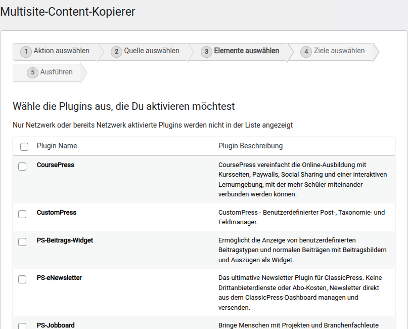

*Für die Plugin-Auswahl genügt das Häkchen in der Tabelle; es gibt hier keine zusätzliche Inhalts-Auswahlliste.*

Nicht angezeigt werden Plugins, die nur netzwerkweit eingesetzt werden können oder bereits netzwerkweit aktiviert sind. Ein auf der Zielwebsite bereits aktives Plugin wird nicht nochmals aktiviert.

Die Auswahl **Alle Seiten** wird bei dieser Aktion nicht angeboten.

## 11. Eigene Beitragstypen kopieren

Eigene Beitragstypen sind Inhalte, die durch zusätzliche Plugins bereitgestellt werden, beispielsweise Produkte, Veranstaltungen oder Kurse.

1. Wähle **Benutzerdefinierter Beitragstyp (Produkte, Veranstaltungen...)**.
2. Wähle die Quellwebsite.
3. Wähle den angebotenen Beitragstyp. Mit **Beitragstypen aktualisieren** kannst du die Liste neu laden.
4. Wähle die Inhalte aus und füge sie der Auswahlliste hinzu.
5. Wähle Zusatzoptionen und Zielwebsites wie bei Beiträgen.
6. Prüfe das Ergebnis in der Verwaltung des betreffenden Inhaltstyps.

**Aktiviere die zugehörigen Funktionen zuerst auf der Zielwebsite.** Eine übernommene Veranstaltung oder ein Produkt ersetzt nicht die Einrichtung des Veranstaltungs- oder Shop-Plugins.

Prüfe bei komplexen Inhalten besonders Bilder, Kategorien, Varianten, Verknüpfungen und die öffentliche Darstellung. Die normale Inhaltskopie ist keine Zusage, dass alle Daten eines beliebigen zusätzlichen Plugins vollständig übertragen werden.

## 12. PS Blog Templates verwenden

Die Integration ist optional. Für normale Webseiten-Gruppen brauchst du sie nicht.

1. Installiere und aktiviere **PS Blog Templates** im Netzwerk.
2. Öffne **Content Kopierer → Einstellungen**.
3. Setze unter **PS Blog Templates-Integration** das Häkchen bei **Aktivieren**.
4. Klicke auf **Änderungen speichern**.

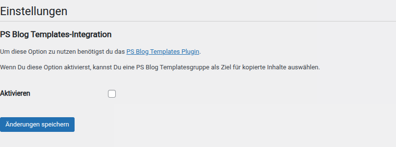

Danach kannst du die zusätzlichen Blog-Vorlagengruppen als Ziele verwenden. In der Gruppenverwaltung erscheint außerdem der entsprechende zusätzliche Tab.

Gemeint sind die Websites der jeweiligen Vorlagengruppe. Die Option ist keine allgemeine Theme- oder Layout-Kopierfunktion.

Ist PS Blog Templates nicht aktiv, kann die Integration nicht eingeschaltet werden. Für einen ersten Test nutze weiterhin eine einzelne Zielwebsite oder eine normale Webseiten-Gruppe.

## 13. Kopieraufträge und größere Netzwerke

### Warum die Zielwebsite aufgerufen werden muss

Der Assistent legt für die Ziele Kopieraufträge an. Die jeweilige Zielwebsite verarbeitet diese beim nächsten Aufruf ihrer Website oder ihrer eigenen Verwaltung.

**Nur die Netzwerkverwaltung aufzurufen reicht dafür nicht.**

Wenn ein Inhalt nach der Abschlussmeldung noch fehlt:

1. Öffne das Dashboard der Zielwebsite.
2. Lass den Aufruf fertig laden.
3. Öffne die passende Inhaltsliste.
4. Prüfe dort die neue Kopie.

Das gilt auch für Benutzerübernahmen und Plugin-Aktivierungen.

### Bei „Alle Seiten“

Für größere Netzwerke werden die Ziele schrittweise in die Warteschlange aufgenommen. Lass das Fenster geöffnet, bis dieser Vorgang abgeschlossen ist, und aktualisiere es währenddessen nicht.

Eine Fortschrittsanzeige für das Anlegen der Aufträge bedeutet nicht, dass bereits alle Inhalte auf allen Zielwebsites geprüft wurden.

### Praktische Vorgehensweise

- Beginne mit wenigen Inhalten und einem Ziel.
- Prüfe neue Inhaltstypen und Bildübernahmen zunächst separat.
- Arbeite anschließend mit überschaubaren Webseiten-Gruppen.
- Rufe die Ziele auf und kontrolliere Stichproben.
- Starte keine unnötigen parallelen Großaufträge.

## 14. Ergebnisse prüfen und Probleme lösen

### Checkliste nach einem Kopierauftrag

- [ ] Die Zielwebsite wurde nach dem Auftrag aufgerufen.
- [ ] Der Inhalt steht in der passenden Liste.
- [ ] Titel und Text stimmen.
- [ ] Veröffentlichungsstatus und Datum passen.
- [ ] Autor und benötigte Zugriffsrechte wurden geprüft.
- [ ] Bilder und Beitragsbild sind erreichbar.
- [ ] Kategorien, Kommentare und Elternseiten passen zu den gewählten Optionen.
- [ ] Die öffentliche Ansicht wurde kontrolliert.

### Häufige Situationen

| Situation | Was du prüfen solltest |
| --- | --- |
| **Content Kopierer fehlt im Menü** | Bist du in der Netzwerkverwaltung und ist das Plugin netzwerkweit aktiv? Hat dein Konto die nötigen Rechte? |
| **Die Quelle wird nicht gefunden** | Suche nach Unterordner oder Subdomain und klicke einen Suchvorschlag an. Alternativ nutze die Website-ID. |
| **„Mindestens ein Element“ wird verlangt** | Füge die markierten Inhalte ausdrücklich zur separaten Auswahlliste hinzu. |
| **Die Zielauswahl ist leer** | Bei Einzelzielen musst du nach der Auswahl auf **Seite hinzufügen** klicken. |
| **Die Meldung erscheint, aber der Inhalt fehlt** | Öffne die Verwaltung der Zielwebsite. Prüfe anschließend Inhaltstyp, Filter und Papierkorb. |
| **Ein zweiter Lauf übernimmt keine Änderungen** | Vorhandene Kopien werden bewusst übersprungen. Bearbeite sie auf dem Ziel; es gibt keine automatische Synchronisierung. |
| **Bilder wurden nicht übernommen** | War **Bilder kopieren** beim ersten Kopierlauf ausgewählt? Ist die Quelle erreichbar? Ein erneuter Lauf ergänzt keine Bilder an einer vorhandenen Kopie. |
| **Eine Gruppe wird nicht angeboten oder enthält keine Ziele** | Prüfe unter **Seiten-Gruppen → Webseiten** die Zuordnung der Websites. |
| **Ein Benutzer erhält keinen neuen Zugriff** | Rufe die Zielwebsite auf und prüfe ihre Benutzerliste. Bereits vorhandene Mitgliedschaften und Rollen bleiben unverändert. |
| **Ein Plugin fehlt in der Auswahl** | Prüfe, ob es installiert, nur netzwerkweit verwendbar oder bereits netzwerkweit aktiv ist. |
| **Ein eigener Beitragstyp fehlt** | Prüfe die Quellwebsite und das dazugehörige Plugin; lade die Beitragstypen neu. |
| **Die öffentliche Seite sieht leer oder anders aus** | Prüfe zuerst, ob der Inhalt im Ziel-Editor vorhanden ist. Danach kontrolliere Theme, Seitenvorlage und benötigte Plugins. |
| **Die Blog Templates-Integration lässt sich nicht aktivieren** | PS Blog Templates muss zuerst im Netzwerk aktiviert sein. |

Bei unerwarteten Fehlern prüfe erst die Zielwebsite, bevor du denselben Auftrag erneut startest. Halte für eine Support-Anfrage Quell- und Zielwebsite, Inhaltstyp, gewählte Optionen und die genaue Fehlermeldung bereit. Gib keine Passwörter weiter.

## 15. Häufige Fragen

### Wird das Original gelöscht?

Nein. Das Plugin kopiert beziehungsweise fügt hinzu. Es verschiebt keine Originalinhalte.

### Kann ich zwischen zwei unabhängigen Installationen kopieren?

Diese Anleitung und die Plugin-Oberfläche sind für Kopien **innerhalb desselben Multisite-Netzwerks** vorgesehen.

### Wird eine komplette Website geklont?

Nein. Du wählst bestimmte Inhalte, Benutzer oder Plugin-Aktivierungen aus. Themes, Menüs, Website-Einstellungen und alle Einstellungen zusätzlicher Plugins werden nicht als vollständige Website übernommen.

### Werden vorhandene Zielinhalte überschrieben?

Bereits erkannte Kopien werden übersprungen. Andere Zielinhalte werden nicht anhand gleicher Titel ersetzt.

### Kann ich eine Kopie wieder rückgängig machen?

Es gibt keinen gemeinsamen Rückgängig-Button für einen ganzen Auftrag. Du kannst kopierte Inhalte auf der Zielwebsite in den Papierkorb verschieben, Benutzerrechte dort anpassen oder aktivierte Plugins dort deaktivieren. Sichere vorher wichtige Daten.

### Warum werden gleichnamige Inhalte nicht zusammengeführt?

Ein gleicher Titel beweist nicht, dass es derselbe Originalinhalt ist. Die Kopiererkennung verwendet deshalb die Herkunft des Inhalts.

### Brauche ich PS Blog Templates?

Nein. Die normale Kopierfunktion und die eigenen Webseiten-Gruppen funktionieren ohne diese Integration.

---

[Zurück zur Plugin-Übersicht](../README.md)
